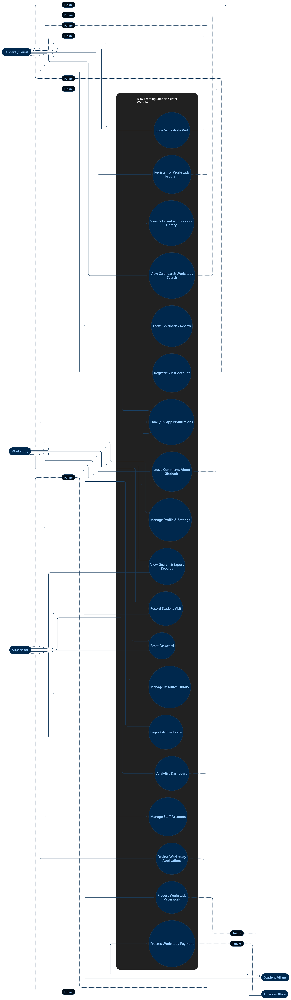

# RHU Learning Support Center Website

**Rafik Hariri University**  
**Final Year Project**  
**Progress Report**

## Group Members

- Bahaa El Rawass
- Ali Gharable
- Mahdi Dagher
- Rand Al Yaman

## 1. Project Definition

The RHU Learning Support Center Website is a role-based web platform for Rafik Hariri University. It replaces manual and paper-based tracking of tutoring and workstudy visits with a centralized, searchable system. In the current phase, authorized Center staff record student visits, capture the courses for which support was requested, and maintain a reliable history of activity.

The wider project vision is a complete workstudy lifecycle system. It will allow students to register for the program, allow supervisors to review applicants and organize schedules, support direct booking of tutoring visits, and preserve records across semesters.

## 2. Project Description

The Learning Support Center needs a structured system for recording student support visits and managing the staff who provide that support. Before this website, information was handled through manual data entry with limited search, inconsistent structure, and weak separation between staff permissions. The current application provides one authenticated portal for daily Center operations.

### 2.1 Objectives

Current objectives are to:

- Record student visits with the student's name, ID, department, courses requested, visit date and time, and optional email.
- Distinguish Supervisor and Workstudy staff roles, while allowing Supervisors to manage staff accounts.
- Search, filter, and export student visit records by student details, department, date, or course.
- Provide account settings for profile details, security, appearance, and record-related options.
- Provide a feedback and issue-reporting channel for staff.
- Maintain a typed, extendable technical foundation for future self-service workflows.

## 3. Requirements Analysis

### 3.1 Functional Requirements

The system currently implements the following functional requirements:

| Requirement            | Implemented behavior                                                                                                             |
| ---------------------- | -------------------------------------------------------------------------------------------------------------------------------- |
| Authentication         | Staff can log in and request password resets by email.                                                                           |
| Student visit entry    | Staff can create a student visit record, capture visit details, and connect it with an existing student when appropriate.        |
| Student records        | Staff can view, search, filter, and export student visit records.                                                                |
| Staff accounts         | Supervisors can create, edit, and delete Supervisor and Workstudy accounts, including role, department, courses, and time slots. |
| Account settings       | Each user can manage personal details, security, appearance preferences, and permitted record-related actions.                   |
| Feedback and reporting | Users can submit feedback or report issues through the Support area.                                                             |
| Dashboard              | Authenticated staff can access a home dashboard with relevant information.                                                       |

### 3.2 Nonfunctional Requirements

| Requirement     | How the system addresses it                                                                                                    |
| --------------- | ------------------------------------------------------------------------------------------------------------------------------ |
| Security        | Role-aware access uses Supabase Auth and server-side Edge Functions for sensitive account actions.                             |
| Performance     | TanStack React Query manages fetching and caching to reduce unnecessary requests.                                              |
| Usability       | The interface uses accessible shadcn and Radix UI primitives with light and dark appearance support.                           |
| Maintainability | Supabase services are separated from React Query hooks and database access is typed through generated schema types.            |
| Reliability     | Edge Functions follow structured logging and consistent data and error response shapes.                                        |
| Scalability     | Backend logic is isolated in Edge Functions so future workflows can be added without restructuring the core client data layer. |

## 4. Literature Review

The system is organized around the Center's present staff roles and the future student-facing workflows needed to run the program end to end. The current design treats students as the subject of visit records. The proposed design introduces students as authenticated participants and connects the Center with Student Affairs and the Finance Office.

### 4.1 Users of the System

| User             | Role in the system                                                                                                                           |
| ---------------- | -------------------------------------------------------------------------------------------------------------------------------------------- |
| Supervisor       | Administrative Learning Support Center staff member responsible for account management, workstudy coordination, and future applicant review. |
| Workstudy Staff  | Student employee or tutor who delivers day-to-day Center support and records student visits.                                                 |
| Student or Guest | Currently a visit-record subject; planned as a guest account holder who can register for workstudy or book a visit.                          |
| Student Affairs  | Planned external stakeholder for workstudy paperwork and approval processes.                                                                 |
| Finance Office   | Planned external stakeholder that receives payment transaction information.                                                                  |

### 4.2 Services Offered for Each User

| User             | Services                                                                                                                                                                                                                                     |
| ---------------- | -------------------------------------------------------------------------------------------------------------------------------------------------------------------------------------------------------------------------------------------- |
| Supervisor       | Current: manage staff accounts, assign departments, courses, and time slots; access all workstudy functions; manage own settings. Future: review applications, adjust proposed schedules, accept or reject applicants, and monitor statuses. |
| Workstudy Staff  | Current: log visits, search and export records, manage own settings, submit feedback, and view the dashboard. Future: view their calendar and decline a booking when an urgent conflict arises.                                              |
| Student or Guest | Current: receives support as a recorded student. Future: view the website, register for workstudy, confirm or deny a proposed schedule, book or cancel tutoring visits, and view application or booking status.                              |
| Student Affairs  | Future: work with the Center through a page or subdomain that supports workstudy paperwork.                                                                                                                                                  |
| Finance Office   | Future: receive payment transaction notifications and the information required to process or prepare payment collection.                                                                                                                     |

## 5. Use Case Diagram

**Figure 1.** Mermaid use case diagram source for the RHU Learning Support Center system.

## 6. Future Ideas and Roadmap

The current website mainly supports data entry by Supervisors and Workstudy Staff. The following roadmap expands it into a system that simplifies program registration, automates the wider workstudy process, and provides analytics, feedback, resource sharing, and optional mobile access.

**Idea 0 Guest accounts.** Allow normal students to create guest accounts and view the website.

**Idea 1 Workstudy registration.** Create a dedicated registration page where students submit their name, ID, courses they want to teach, time slots, transcript, and schedule.

**Idea 2 Applicant review and account provisioning.** Replace the staff page with an applicant-management workspace. Supervisors can review applications, adjust courses or time slots, and accept or reject applicants. Accepted applicants receive an email containing the proposed schedule and can confirm or deny it. Confirmation automatically creates an account using the email provided and the student's ID as the initial password. A denial routes the email conversation to the supervisor. The website displays waiting, confirmed, or denied status in a table.

**Idea 3 Calendar and workstudy search.** Replace the Home page with a calendar of workstudy time slots and their details, plus search by name, time slot, date, course, and related fields.

**Idea 4 Student booking.** Allow guest accounts to book workstudy visits using the information normally entered by staff: name, ID, visit date, courses, and optional email. Booking creates the visit record automatically and emails both the guest and workstudy staff member. The workstudy can decline a booking when necessary and the guest can cancel it.

**Idea 5 Student Affairs integration.** Integrate workstudy paperwork with Student Affairs after a joint process review. This may be delivered as a separate page or a dedicated subdomain.

**Idea 6 About Learning Support Center.** Add an About page describing the Learning Support Center and the current hourly rate in Lebanese lira and US dollars, including the semester amount where applicable.

**Idea 7 Workstudy payments.** Support payment by card, Wish, or a scheduled in-person Finance Office collection. Once a payment method is selected, the Finance Office receives an email with the required transaction details.

**Idea 8 Data preservation across semesters.** Add semester-scoped records so historical data remains available when a new term begins and current data is not overwritten.

**Idea 9 Analytics Dashboard.** Provide Supervisors with real-time analytics showing the most requested courses, the number of visits per semester and per Workstudy with average visit counts, peak visiting hours, student attendance trends, and Workstudy performance metrics such as sessions conducted, student feedback, and attendance.

**Idea 10 Student feedback and Workstudy comments.** Allow students to leave reviews and comments about the Workstudy who supported them, including constructive or negative feedback about explanation quality, availability, or repeated absences. Workstudy Staff can also leave private comments about students after visits. A student comment should be associated with the relevant Workstudy, while a Workstudy comment should be visible only to the Workstudy who wrote it and to Supervisors.

**Idea 11 Automated email reminders.** Extend the student booking workflow with automated email reminders for upcoming visits. This feature is considered part of the booking system and should notify students and Workstudy Staff before a scheduled session.

**Idea 12 Resource Library.** Provide a shared library where Workstudy Staff and Supervisors can upload useful documents, lecture slides, study materials, and links that can support students and make frequently used resources easier to access.

**Idea 13 Optional mobile application.** If development time remains, create a mobile version of the system using React Native. Possible features include push notifications as an alternative to email notifications, offline access to selected Resource Library content, and other mobile-focused features identified after the core web system is completed.

## Implementation Considerations

- Restrict feedback, internal student comments, analytics, and other sensitive records according to role and define who can view, moderate, or export them.
- Build analytics from semester-scoped visit, booking, attendance, and feedback data so historical comparisons remain accurate.
- Define upload permissions, file types, storage limits, and access rules before opening the Resource Library to staff.
- Confirm database policies and role permissions before exposing student-facing workflows.
- Keep account provisioning, email dispatch, payment notifications, and other sensitive actions in protected server-side functions.
- Define semester entities and status history before migrating visit records so data remains auditable.
- Meet Student Affairs and the Finance Office before finalizing their workflows, data requirements, and notification channels.
